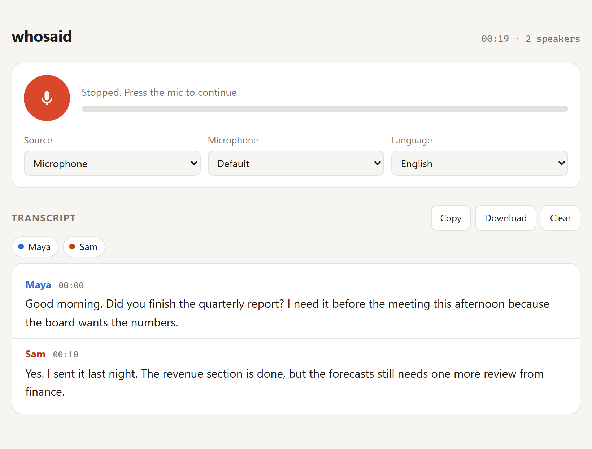

# whosaid

Real-time speech-to-text in the browser, with speaker labels. Transcribe your microphone, a browser tab, your whole computer's audio (a Zoom/Meet/Teams call, a video), or both at once, and see who said what as it happens.



## Features

- **Live transcription:** words appear as they're spoken and are corrected as the sentence finishes ([Deepgram](https://deepgram.com) Nova-3 streaming).
- **Speaker diarization:** each voice gets its own label and colour, and a speaker's words stay in one paragraph until someone else talks.
- **Three audio sources:**
  - *Microphone*
  - *Computer audio*: a tab or the entire screen, via the browser's share dialog. Works with earphones in.
  - *Computer audio + my mic*: the two are sent as separate channels, so you're always labelled **You** and everyone else is told apart by voice.
- **Rename speakers** inline. Renaming two labels to the same name merges them in the view and the export.
- **Survives network drops:** audio is buffered while it reconnects, and audio that hadn't been finalised is replayed, so nothing is lost.
- **Copy or download** the transcript as timestamped text. It also persists across page reloads.
- **No dependencies, no build step:** a ~110-line Python standard-library server, one HTML page and one plain JS module.

## Quick start

Requirements: Python 3.9+, Chrome or Edge, and a [Deepgram API key](https://console.deepgram.com) (new accounts include free credit).

```bash
git clone https://github.com/cjhirwa/whosaid.git
cd whosaid
cp .env.example .env        # then paste your key into .env
python server.py
```

Open <http://localhost:8765> and press the mic button (or the Space key).

> **The key needs Member permission or higher.** The server mints short-lived tokens with it, and keys with the lowest role get `403: Insufficient permissions`. Create one under *API Keys* in the Deepgram console.

### Transcribing computer audio

Choose **Computer audio** as the source and press the mic. In the browser's share dialog:

- **One tab** (YouTube, Google Meet in the browser…): pick the tab and keep **Share tab audio** on.
- **Everything** (desktop Zoom, Teams, Spotify…): pick **Entire screen** and turn on **Share system audio** (Windows; macOS only allows tab audio).

Only audio is used; the video is discarded.

## How it works

```text
 browser                                   server.py                 Deepgram
 ───────                                   ─────────                 ────────
 mic / tab / screen ─► AudioWorklet
                       (16-bit PCM, 100 ms chunks)
                                 GET /token ───────► POST /v1/auth/grant
                                 ◄─── 60 s JWT ◄────
 WebSocket  wss://api.deepgram.com/v1/listen  (auth: JWT) ◄──────────────►
            ◄── interim + final results with per-word speaker ids
```

- **The API key never reaches the browser.** The page gets a 60-second token from the local server, which is only valid for opening the stream. The server listens on `127.0.0.1` only and rejects requests with other `Host` headers, which blocks DNS-rebinding attacks.
- **Audio is streamed as raw PCM** rather than a WebM recording, so a dropped connection can resume mid-stream. Recent audio is kept, and after a reconnect everything after the last finalised word is resent.
- **Speaker labels are scoped to a connection.** Deepgram numbers speakers per stream, so the app keys them as `connection:channel:speaker` and names never jump to the wrong person.

## Configuration

Set these in `.env` or as environment variables:

| Variable | Default | Description |
| --- | --- | --- |
| `DEEPGRAM_API_KEY` | (required) | Deepgram key with Member role or higher |
| `DEEPGRAM_MODEL` | `nova-3` | Any Deepgram streaming model |
| `PORT` | `8765` | Local port for the web UI |

## Limitations

- **Diarization is voice-based and can take a few seconds to settle.** Similar voices may be merged, and one person can occasionally be split in two; renaming fixes both in the view.
- **Speaker numbering restarts with each new connection** (after Stop/Start or a reconnect), so the same person may get a new number. Rename them to the same name to merge them.
- **Language must be chosen up front.** Deepgram streaming has no auto-detect; *Multilingual* handles speech that mixes languages.
- **Echo in "Computer audio + my mic" mode:** use earphones, or your mic also picks up the other side.
- **Firefox and Safari can't capture tab or system audio;** microphone mode works there.

## Project layout

| File | What it does |
| --- | --- |
| `server.py` | Serves the page and mints Deepgram tokens (Python standard library only) |
| `index.html` | UI, audio capture and the Deepgram connection |
| `core.js` | Pure logic with no DOM or network access: transcript model, speaker keys, PCM encoding and reconnect buffering |
| `tests/` | `test_server.py` (unittest) and `core.test.js` (Node's built-in `node:test`) |

## Development

```bash
python -m unittest discover -s tests -v   # server
node --test                               # core.js (Node 18+)
```

Neither suite needs network access, an API key or any installed packages.

## License

Released under the [MIT License](LICENSE).
